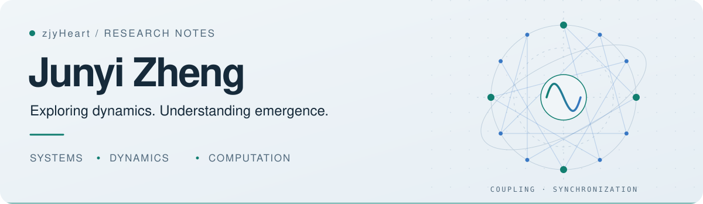
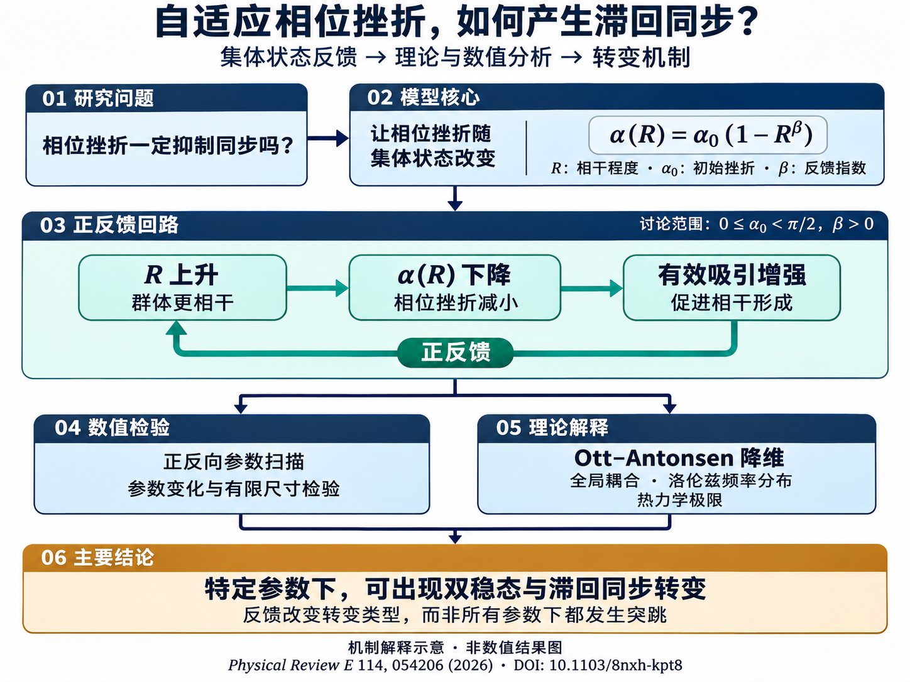
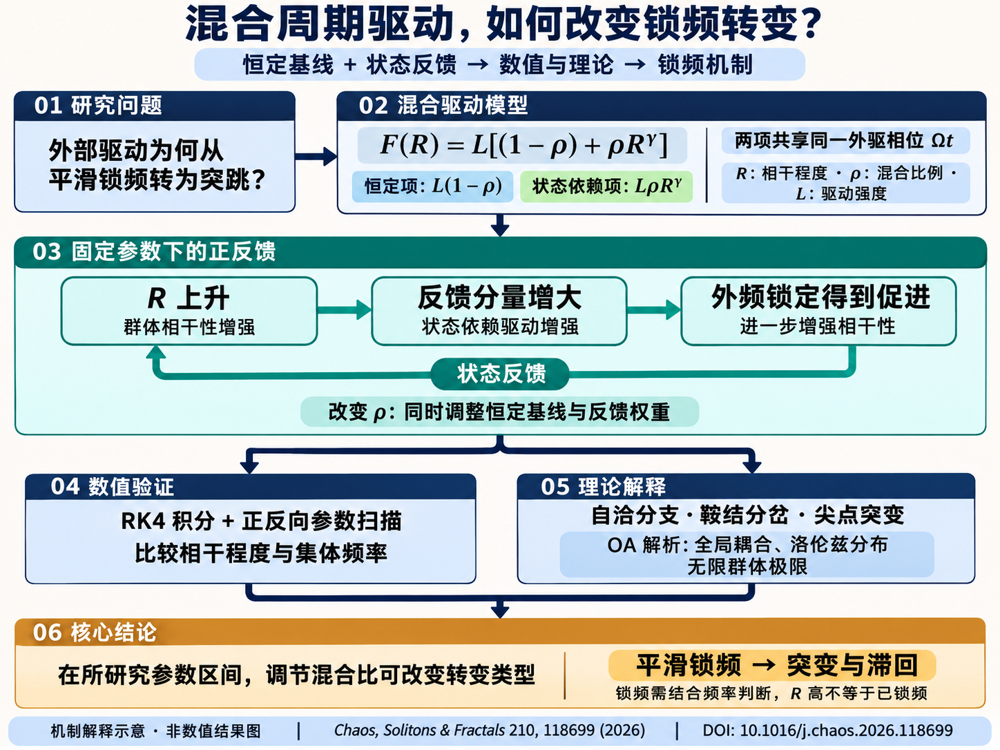

<picture>
  <source media="(prefers-color-scheme: dark)" srcset="./assets/header-dark.svg">
  <source media="(prefers-color-scheme: light)" srcset="./assets/header-light.svg">
  
</picture>

# 你好，我是 Junyi Zheng

关注 **系统科学、非线性动力学与集体行为**，研究耦合振子在外部驱动下的同步与锁频现象。也构建用于信息整理和知识追溯的 AI 工具。

[研究方向](#研究方向) · [论文与代码](#论文与代码) · [工具与实践](#工具与实践) · [阅读笔记](#阅读笔记)

## 研究方向

- **同步与锁频** — 耦合振子、周期驱动与集体动力学。
- **非线性转变** — 分岔、双稳态、滞回与突变现象。
- **数值探索** — 用动力学仿真和参数扫描连接模型与现象。

## 论文与代码

### Hysteretic synchronization transitions induced by adaptive phase frustration

**Junyi Zheng**, Changgui Gu, Jiangsheng Wang, Yuxuan Song 
*Physical Review E* **114** (2026), 054206

研究自适应相位挫折如何通过集体状态反馈诱导双稳态与滞回同步转变，并结合数值扫描和 Ott–Antonsen 降维解释转变机制。

   
  AI 机制解释示意图 · 研究问题 → 状态反馈 → 数值与理论 → 主要结论 · 点击查看高清图

[论文 DOI ↗](https://doi.org/10.1103/8nxh-kpt8)　 /　 [APS 期刊页面 ↗](https://journals.aps.org/pre/abstract/10.1103/8nxh-kpt8)

第一作者 · 2026 年 11 月 3 日正式发表

### Hybrid forcing control of entrainment transitions

**Junyi Zheng**, Changgui Gu, Jiangsheng Wang, Guolin Wu  
*Chaos, Solitons & Fractals* **210** (2026), 118699

研究混合周期驱动如何改变振子群体的锁频转变，关注连续转变、突变与滞回之间的联系。

   
  AI 机制解释示意图 · 混合驱动 → 正反馈 → 分析方法 → 锁频转变 · 点击查看高清图

[论文 DOI ↗](https://doi.org/10.1016/j.chaos.2026.118699)　 /　 [MATLAB 参考实现 ↗](https://github.com/zjyHeart/hybrid-forcing-entrainment-simulations)

代码仓库提供经过整理与重构的参考实现，用于方法学习和数值实验；不是论文原始仿真代码，不保证与原始输出逐点一致。

## 工具与实践

在研究之外，也尝试把信息采集、文献阅读与知识整理中的想法做成工具。

**[Evidex · 可追溯知识库 ↗](https://github.com/zjyHeart/evidex-enterprise-traceable-rag)**  
文档异步入库、权限内检索与带引用问答，通过 MCP 提供知识库能力。  
Python · FastAPI · PostgreSQL · RAG

**[Signal Desk · 热点信号台 ↗](https://github.com/zjyHeart/AI_hotspot)**  
面向 AI 编程与 Agent 的本机信息工作台，串联多源采集、事件聚合与分阶段核验，保留原文依据。  
TypeScript · Next.js · SQLite · 信息追踪

**[澄录 · Obsidian 视频笔记 ↗](https://github.com/zjyHeart/obsidian-video-notes)**  
将 YouTube、B 站观看过程整理成带时间戳的 Markdown 笔记，写入授权的 Obsidian Vault。  
TypeScript · React · Chrome Extension · 知识整理

## 阅读笔记

**[Tau Coding Agent 源码分析 ↗](https://github.com/zjyHeart/tau-coding-agent-source-analysis)**  
从启动链路到 Agent Loop，用中文记录工具调用、会话管理与上下文组织的源码阅读过程。

---

**常用工具**　`MATLAB` `Python` `TypeScript` `Obsidian`  
从模型理解现象，从证据积累知识。 / Explore the dynamics. Follow the evidence.
